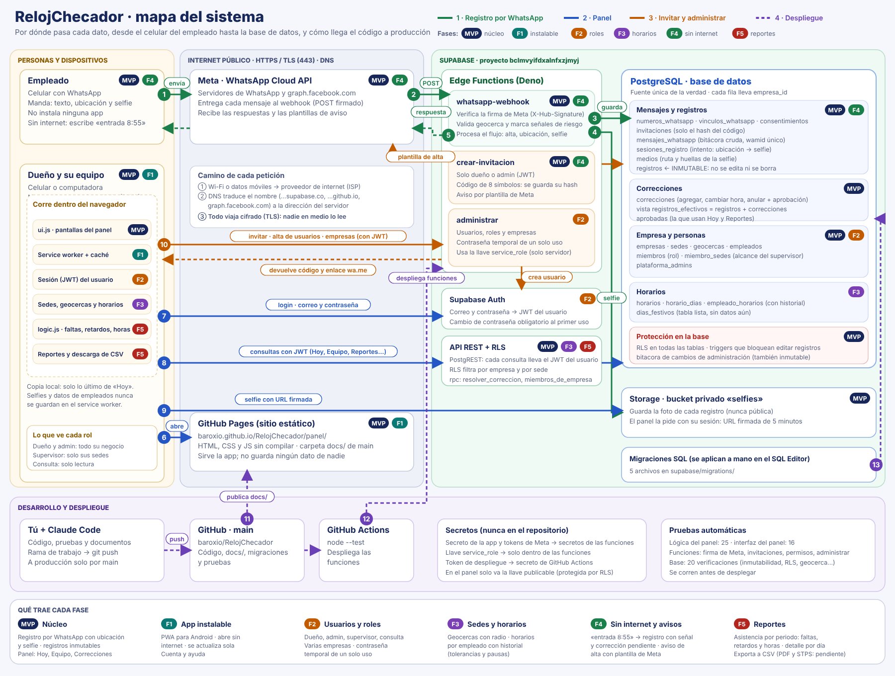

# Mapa del sistema

El archivo editable es [`img/mapa-del-sistema.svg`](img/mapa-del-sistema.svg) (se abre en cualquier navegador). Muestra, de izquierda a derecha, las personas y sus dispositivos, el internet público (Meta, DNS y TLS, GitHub Pages) y Supabase (funciones, Auth, API con RLS, Postgres y Storage), más el camino del código a producción y qué trae cada fase.

Los cuatro recorridos de datos:
1. **Registro por WhatsApp:** empleado → Meta → `whatsapp-webhook` → Postgres y Storage → respuesta por Meta.
2. **Panel:** navegador → GitHub Pages (la app) → Supabase Auth (JWT) → API REST con RLS → Postgres; la selfie con URL firmada de Storage.
3. **Invitar y administrar:** panel → `crear-invitacion` / `administrar` → Postgres y Auth; aviso por plantilla de Meta.
4. **Despliegue:** git push → GitHub (main) → Actions despliega las funciones y Pages publica `docs/`; las migraciones SQL se aplican a mano.
