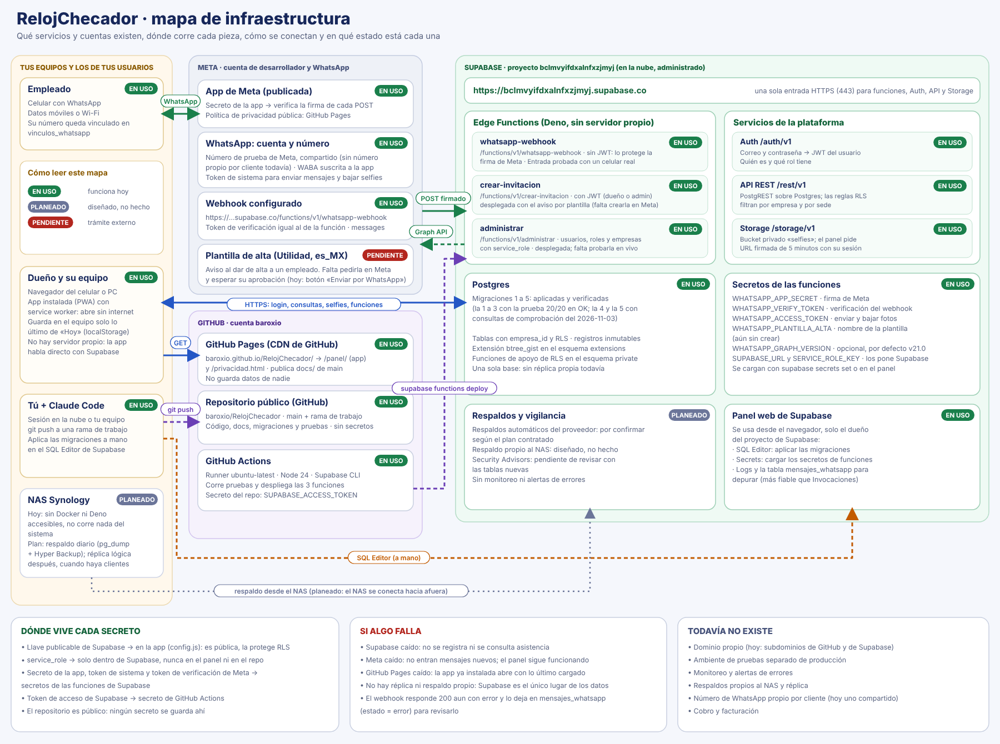

> Para la vista actual (NAS, Cloudflare, número real) mira [`documentacion-sistema.md`](documentacion-sistema.md) y el [mapa de tecnologías](img/mapa-tecnologias.svg). Los mapas de abajo son del diseño inicial y siguen mostrando GitHub Pages.

# Mapa del sistema

El archivo editable es [`img/mapa-del-sistema.svg`](img/mapa-del-sistema.svg) (se abre en cualquier navegador). Muestra, de izquierda a derecha, las personas y sus dispositivos, el internet público (Meta, DNS y TLS, GitHub Pages) y Supabase (funciones, Auth, API con RLS, Postgres y Storage), más el camino del código a producción y qué trae cada fase.

Los cuatro recorridos de datos:
1. **Registro por WhatsApp:** empleado → Meta → `whatsapp-webhook` → Postgres y Storage → respuesta por Meta.
2. **Panel:** navegador → GitHub Pages (la app) → Supabase Auth (JWT) → API REST con RLS → Postgres; la selfie con URL firmada de Storage.
3. **Invitar y administrar:** panel → `crear-invitacion` / `administrar` → Postgres y Auth; aviso por plantilla de Meta.
4. **Despliegue:** git push → GitHub (main) → Actions despliega las funciones y Pages publica `docs/`; las migraciones SQL se aplican a mano.

---

# Mapa de infraestructura

Editable: [`img/mapa-infraestructura.svg`](img/mapa-infraestructura.svg). Muestra las cuentas y servicios (equipos de los usuarios, Meta, GitHub y Supabase), las URL y protocolos entre ellos, dónde vive cada secreto y el estado de cada pieza:

- **En uso:** funciona hoy. Las 6 migraciones están aplicadas y las 3 funciones desplegadas y activas (verificado el 2026-11-03 contra el proyecto real); falta probar `administrar` y el registro diferido en vivo.
- **Por aplicar:** el respaldo diario al NAS (script listo, falta instalarlo; ver `docs/respaldos.md`).
- **Planeado:** la réplica lógica de la base en el NAS.
- **Pendiente:** la plantilla de Meta para el aviso de alta.

Hay que actualizarlo cuando cambie el estado (por ejemplo, al aplicar las migraciones o aprobar la plantilla): se regenera editando el SVG.
