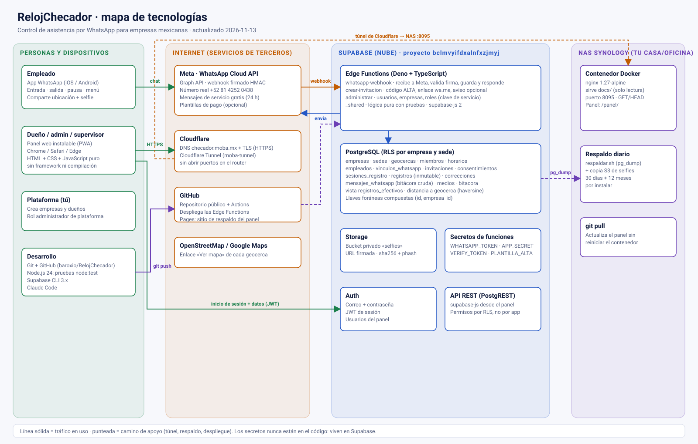

# RelojChecador: documentación del sistema

Control de asistencia por WhatsApp para empresas mexicanas. El empleado registra entrada, salida y pausas desde su WhatsApp (con ubicación y selfie); el dueño o supervisor lo ve y lo corrige en un panel web instalable.

Actualizado: 2026-11-13. Este documento resume cómo está armado hoy; el detalle de cada parte está en los documentos enlazados al final.

El mapa es [`img/mapa-tecnologias.svg`](img/mapa-tecnologias.svg) (se abre en cualquier navegador y se edita como texto).

---

## 1. Piezas y tecnologías

| Pieza | Tecnología | Dónde vive | Para qué sirve |
|---|---|---|---|
| Canal del empleado | WhatsApp Business Platform (Cloud API de Meta, Graph API) | Meta | Recibe y envía mensajes. Número real **+52 81 4252 0438**. |
| Webhook del bot | Supabase Edge Function `whatsapp-webhook` (Deno + TypeScript) | Supabase | Valida la firma de Meta, guarda el mensaje y ejecuta el flujo de registro. |
| Invitaciones | Edge Function `crear-invitacion` | Supabase | Genera el código `ALTA XXXX` y el enlace `wa.me`. |
| Administración | Edge Function `administrar` | Supabase | Crea usuarios y empresas, cambia roles, reinicia contraseñas (usa la clave de servicio). |
| Lógica compartida | `supabase/functions/_shared` (TypeScript puro) | Repositorio | Firma, lectura del payload, comandos, permisos, invitaciones. Tiene pruebas. |
| Base de datos | PostgreSQL de Supabase con RLS | Supabase | Empresas, sedes, geocercas, empleados, registros, correcciones, bitácora. |
| Archivos | Supabase Storage (bucket privado `selfies`) | Supabase | Selfies de cada registro; URL firmada para verlas. |
| Inicio de sesión | Supabase Auth (correo y contraseña, JWT) | Supabase | Usuarios del panel. |
| Panel | HTML + CSS + JavaScript sin framework ni compilación; PWA (`manifest`, `sw.js`); `supabase-js` y `qrcode-generator` en `docs/panel/vendor` | NAS | Hoy, equipo, reportes, correcciones, lugares, horarios, usuarios. |
| Servidor del panel | nginx 1.27-alpine en Docker (solo lectura, solo GET/HEAD) | NAS Synology, puerto 8095 | Entrega los archivos estáticos de `docs/`. |
| Acceso desde fuera | Cloudflare Tunnel (`moba-tunnel`) + DNS y TLS de Cloudflare | Cloudflare | `https://checador.moba.mx/panel/` sin abrir puertos del router. |
| Código y despliegue | Git, GitHub (`baroxio/RelojChecador`), GitHub Actions, Supabase CLI | GitHub | Pruebas y despliegue de las funciones. |
| Respaldo | `respaldo/respaldar.sh` (pg_dump + copia S3 de selfies) | NAS | Respaldo diario. **Script listo, falta instalarlo.** |

El proyecto de Supabase es `bclmvyifdxalnfxzjmyj`.

## 2. Cómo fluyen los datos

### 2.1 Registro por WhatsApp
1. El empleado escribe `entrada`, `salida`, `pausa` o toca un botón del menú.
2. Meta manda un POST firmado (HMAC) a `whatsapp-webhook`. Si la firma no coincide, responde 401.
3. La función guarda el mensaje en `mensajes_whatsapp` (el `wamid` es único: un reenvío no duplica).
4. El bot pide la **ubicación**; se valida contra las geocercas activas de la sede (distancia haversine). Si la sede lo exige, pide **selfie**.
5. Se inserta en `registros` (inmutable) con la hora del servidor y la hora del mensaje, y se confirma por WhatsApp.
6. Un empleado marcado `sin_geocerca` puede registrar desde cualquier lugar; el registro queda anotado como fuera de geocerca.

Menú del empleado activo (lista de WhatsApp): Entrada, Salida, Pausa / regreso y **Mi historial** (sus últimos 10 registros).

### 2.2 Alta de un empleado (sin plantilla de pago)
1. En el panel se crea el empleado con su nombre, sede y teléfono de WhatsApp.
2. En su ficha, **Invitar por WhatsApp** genera el enlace; se entrega con **Mostrar QR** o **Copiar enlace**.
3. El empleado abre el enlace y envía `ALTA CÓDIGO` desde el teléfono registrado (los últimos 10 dígitos deben coincidir). La invitación es de un solo uso y vence a las 72 horas.
4. Acepta el aviso de privacidad con **Acepto** y queda `activo`.

Solo si existe el secreto `WHATSAPP_PLANTILLA_ALTA` la función además manda una plantilla de Meta (con costo). Sin ese secreto no se envía nada y no cuesta.

### 2.3 Panel
Navegador → `checador.moba.mx` (Cloudflare) → nginx en el NAS → archivos estáticos. Después el navegador habla **directo con Supabase**: Auth para la sesión y la API REST con el JWT. Los permisos los aplica la base (RLS), no el NAS. Para crear usuarios, empresas o invitaciones llama a las Edge Functions.

### 2.4 Despliegue
- **Panel:** `git pull` en el NAS. Se sube `VERSION` en `docs/panel/sw.js` para que los teléfonos actualicen la app.
- **Funciones:** un push a `main` que toque `supabase/functions/**` corre las pruebas y despliega por GitHub Actions. A mano: `supabase functions deploy <nombre> --project-ref bclmvyifdxalnfxzjmyj --yes` (el webhook con `--no-verify-jwt`).
- **Base de datos:** las migraciones de `supabase/migrations` se aplican a mano (SQL Editor o CLI).

## 3. Modelo de datos (resumen)

Tablas principales: `empresas`, `sedes`, `geocercas`, `miembros` y `miembro_sedes`, `horarios` y `horario_dias`, `empleados`, `vinculos_whatsapp`, `invitaciones`, `consentimientos`, `sesiones_registro`, `registros`, `correcciones`, `medios`, `mensajes_whatsapp`, `numeros_whatsapp`, `bitacora`, `dias_festivos`. Detalle y diagrama en [`esquema-bd.md`](esquema-bd.md).

Decisiones que conviene recordar:
- **Multiempresa:** `empresa_id` en cada fila y llaves foráneas compuestas `(id, empresa_id)`; la base impide mezclar empresas.
- **Registros inmutables:** solo `insert`. Los cambios van en `correcciones` y la vista `registros_efectivos` los aplica.
- **Número compartido:** una sola fila en `numeros_whatsapp` (`empresa_id` nulo) atiende a todas las empresas.
- **Borrar sedes y geocercas:** solo si no tienen historial; si ya hay empleados o registros, la base lo rechaza y el panel sugiere **desactivar**.

## 4. Roles y seguridad

| Rol | Puede |
|---|---|
| Administrador de plataforma | Crear empresas y sus dueños. |
| Dueño / admin | Todo en su empresa: usuarios, sedes, geocercas, horarios, empleados, correcciones. |
| Supervisor | Ver y corregir solo las sedes que se le asignan. |

- RLS en todas las tablas; el supervisor ve solo sus sedes.
- Las escrituras operativas (bot, usuarios) usan la clave de servicio **solo dentro de las Edge Functions**.
- El panel solo lleva la clave *publicable* (`docs/panel/config.js`). El token de WhatsApp y el secreto de la app viven como secretos de Supabase, nunca en el código.
- nginx sirve `docs/` en solo lectura, con encabezados de seguridad y sin métodos de escritura.
- Las acciones de administración quedan en `bitacora` (tabla inmutable).

## 5. Cuentas y servicios externos

| Servicio | Dato clave | Notas |
|---|---|---|
| Meta / WhatsApp | WABA «MOBA Events» `2113542869525538`; Phone Number ID `1499860373203092` | La cuenta de mensajería lleva el método de pago (Visa, MXN). El usuario de sistema `relojchecador-bot` tiene control total sobre ella. |
| Meta (pruebas) | WABA `1183723973343329`, número de prueba +1 555 642 8542 | Ya no es el que se usa. |
| Supabase | Proyecto `bclmvyifdxalnfxzjmyj` | Funciones, base, Auth, Storage. |
| Cloudflare | Túnel `moba-tunnel`, regla en `/volume1/Docker/cloudflared/config.yml` | `checador.moba.mx` → `http://IP-DEL-NAS:8095`. |
| GitHub | `baroxio/RelojChecador` (público) | Actions despliega las funciones. |

### Costos de WhatsApp
Los mensajes de servicio (respuestas dentro de las 24 h posteriores a un mensaje del empleado) son gratis. Solo las **plantillas** enviadas por la empresa tienen costo. Con el alta por enlace o QR y sin plantilla, el costo de Meta es cercano a cero.

## 6. Pruebas

| Qué | Cómo |
|---|---|
| Lógica de funciones | `node --experimental-strip-types --test supabase/functions/_shared/*.test.ts` |
| Lógica del panel | `node --test docs/panel/logic.test.mjs` |
| Interfaz del panel | `node tests/panel/ui.prueba.mjs` (jsdom) |
| Acción `administrar` | `tests/funciones/administrar.prueba.mjs` |
| Esquema y RLS | `supabase/tests/esquema_prueba.sql` (en el SQL Editor) |
| Respaldo | `bash tests/respaldo/prueba.sh` |

## 7. Operación diaria

- **Actualizar el panel:** `git pull` en `/volume1/Docker/relojchecadorwhatsapp`. No hace falta reiniciar el contenedor.
- **Levantar el panel:** `cd deploy/nas && docker compose up -d`.
- **Ver errores del bot:** tabla `mensajes_whatsapp` (columnas `estado` y `error`) y los *logs* de la función en Supabase.
- **Cambiar de número de WhatsApp:** actualizar la fila de `numeros_whatsapp`, el secreto `WHATSAPP_TOKEN` y el webhook de la app en Meta.

## 8. Pendientes conocidos

- Instalar el respaldo diario al NAS (`docs/respaldos.md`).
- Probar el alta de un empleado de punta a punta en el número real (David Rodríguez y Verónica Velasco siguen «Invitado»).
- Confirmar que el nombre para mostrar de WhatsApp quedó aprobado por Meta.
- **Revocar los tokens que se pegaron en el chat durante las pruebas** (token del usuario de sistema de Meta y token del CLI de Supabase) antes de usar el sistema en producción.
- Opcionales: reporte para la STPS, horas extra, días festivos, recrear la plantilla `alta_empleado` en la cuenta nueva.

## 9. Más documentación

| Documento | Contenido |
|---|---|
| [`funcionalidades.md`](funcionalidades.md) | Funcionalidades y prioridades (MVP, v2, v3). |
| [`esquema-bd.md`](esquema-bd.md) | Esquema de la base y decisiones. |
| [`webhook-whatsapp.md`](webhook-whatsapp.md) | Flujo del bot y de las funciones. |
| [`despliegue-nas.md`](despliegue-nas.md) | Panel en el NAS y acceso desde fuera. |
| [`respaldos.md`](respaldos.md) | Respaldo diario al NAS. |
| [`arquitectura.md`](arquitectura.md) | Mapas anteriores del sistema y de la infraestructura. |
| [`hoja-de-ruta-panel.md`](hoja-de-ruta-panel.md) | Avance del panel. |
| [`../PRODUCT.md`](../PRODUCT.md), [`../DESIGN.md`](../DESIGN.md) | Producto y diseño. |
