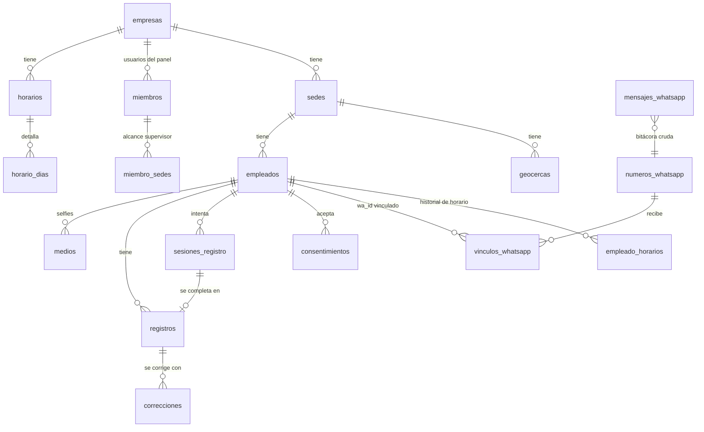

# Esquema de base de datos (MVP)

Archivos: [`supabase/migrations/20261016000000_esquema_inicial.sql`](../supabase/migrations/20261016000000_esquema_inicial.sql) y [`20261016000100_storage_selfies.sql`](../supabase/migrations/20261016000100_storage_selfies.sql).

**Estado:** el SQL pasa el análisis de sintaxis de Postgres (pglast). **No se ha ejecutado** contra una base real ni se ha aplicado al proyecto de Supabase.

## Mapa

## Decisiones clave

| Tema | Decisión | Por qué |
|---|---|---|
| Identificadores | `uuid` en todo | La replicación lógica no sincroniza secuencias |
| Multiempresa | `empresa_id` en cada fila y llaves foráneas compuestas `(id, empresa_id)` | La base impide mezclar datos de dos empresas, no solo la aplicación |
| Registro inmutable | `registros` solo acepta `insert`; un trigger bloquea `update`, `delete` y `truncate` | Es la evidencia ante la STPS |
| Correcciones | Tabla `correcciones` (agregar, modificar hora, anular) con aprobación; la vista `registros_efectivos` las aplica | Se conserva el original y la traza |
| Hora que vale | `ocurrido_at` = hora del servidor; `ts_cliente` = la que reporta WhatsApp | Responde la crítica de Lenox HR de que la hora es la del mensaje |
| Intento vs. registro | `sesiones_registro` guarda el intento (ubicación y luego selfie) y su rechazo; `registros` solo lo completado | El flujo tiene dos mensajes; los rechazos también quedan como evidencia |
| Regla de WhatsApp | `check`: un registro por WhatsApp exige ubicación y `dentro_geocerca` | La regla vive en la base |
| Idempotencia | `mensajes_whatsapp.wamid` único | Meta puede reenviar el mismo mensaje |
| Vínculo de teléfono | `vinculos_whatsapp` con historial; el número activo es único por número de WhatsApp | Cambio de número = señal de riesgo y no se hereda el acceso |
| Número compartido o propio | `numeros_whatsapp.empresa_id` nulo = compartido | Soporta ambas opciones mientras se decide |
| Selfies | Bucket privado `selfies`; `medios` guarda `sha256` y `phash` | Detecta foto repetida sin reconocimiento facial |
| Horarios con historia | `empleado_horarios` con `daterange` y exclusión de traslapes | Los reportes de periodos pasados usan el horario de entonces |
| Zona horaria | Por sede | Hay zonas distintas en México |
| Permisos | RLS con funciones `security definer`; el supervisor ve solo sus sedes; el panel casi no escribe | Las escrituras operativas van por el servidor con `service_role` |
| Bitácora | Trigger en tablas de configuración y correcciones; la tabla también es inmutable | "Bitácora de acciones de administración" del documento de funcionalidades |

## Fuera del esquema (a propósito)

- **Cobro y consumo de mensajes**: depende del modelo de precio (pendiente).
- **Cierre de periodo**: v2.
- **Solicitudes de vacaciones y permisos**: v2.
- **Días festivos oficiales**: la tabla existe, pero no se cargaron datos; hay que generarlos con fuente oficial.
- **Tokens de Meta**: no van en la base; usar Supabase Vault o variables de entorno.

## Pendientes antes de aplicar

1. Ejecutar la migración en una base real (por ejemplo `supabase start` en una máquina con Docker accesible) y probar: inmutabilidad, restricciones, vista y políticas RLS con usuarios de cada rol.
2. Revisar con la aplicación qué escritura necesita el panel además de la configuración.
3. Definir el trabajo de purga por plazo de conservación (usa `set local reloj.permitir_purga = 'on'`).
4. Validar la zona horaria de la sede en la aplicación (la base no la restringe).
5. Decidir si el número de WhatsApp es compartido o por cliente.
